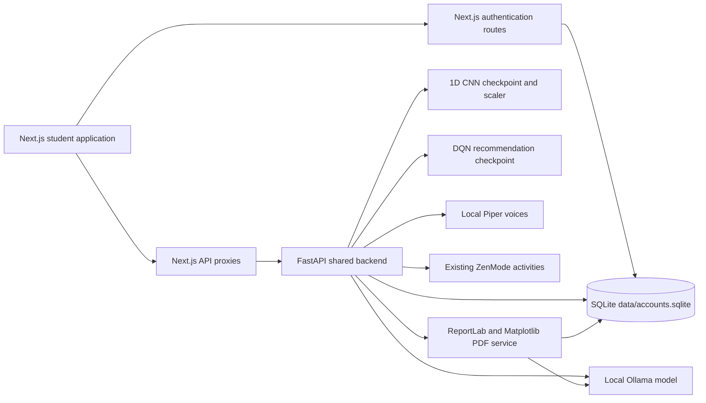
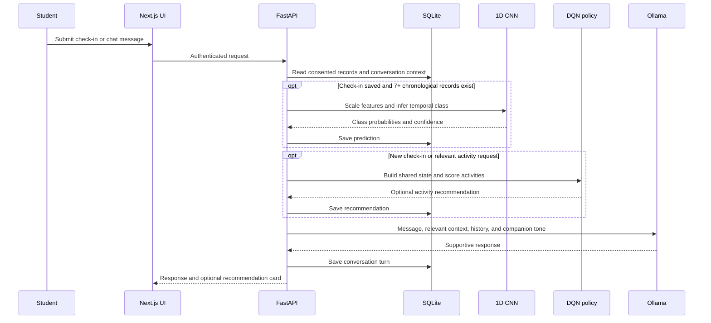

# SASTRA MindCare AI

SASTRA MindCare AI is a student-facing, non-clinical well-being support application. It combines voluntary student check-ins, academic self-care activities, a shared Pixel/Luna chat experience, local AI services, activity tracking, and downloadable reports.

> **Scope and safety:** This project is for reflection and general academic well-being support. It does not diagnose or treat mental health conditions. CNN outputs are patterns in self-reported data; recommendations are optional. Students in serious distress should contact qualified people. The application displays SASTRA SWAS contact information and India emergency number 112.

## Contents

- [Features](#features)
- [Architecture](#architecture)
- [Where the CNN is used](#where-the-cnn-is-used)
- [Where the DQN recommendation agent is used](#where-the-dqn-recommendation-agent-is-used)
- [Technology](#technology)
- [Project layout](#project-layout)
- [Requirements](#requirements)
- [Installation and local run](#installation-and-local-run)
- [Environment configuration](#environment-configuration)
- [Application flow](#application-flow)
- [Data and privacy](#data-and-privacy)
- [HTTP API](#http-api)
- [Model and data limitations](#model-and-data-limitations)
- [Troubleshooting](#troubleshooting)

## Features

- **Pixel and Luna:** Two personalities using the same chat service, student context, conversation history, CNN output, and recommendation policy. The existing chat lets a student switch companions without starting a separate data store.
- **Voice:** Browser speech recognition can fill the chat composer. Local Piper voices provide Pixel's male voice and Luna's female voice when the bundled voice files load.
- **Voluntary check-in:** Mood, perceived stress, sleep duration, academic workload, study duration, physical activity, breaks, and optional activity preferences.
- **Trend observations:** A supplied 1D CNN analyzes a sequence of saved check-ins once enough chronological records exist.
- **Optional activity suggestions:** A supplied DQN policy selects from the existing ZenMode and study-support activities. Students can decline; a decline is not treated as a negative outcome.
- **ZenMode:** Guided breathing, mindfulness, relaxation, visualization, sound presets, a timer, and optional activity feedback.
- **History and progress:** Per-account chat history, deletion controls, and charts backed by saved records.
- **PDF reports:** Weekly, monthly, and custom-range reports generated from the signed-in student's consented data. Reports include the student's account name, daily indicator values, model observations, recommendations, activity progress, and optional AI-generated reflections. Raw chat transcripts are not copied into the PDF.
- **SQLite storage:** The existing account database stores accounts and application records. Redis and Docker are not required to run the app locally.

## Architecture



The browser serves the Next.js App Router UI. Next.js authentication uses `better-sqlite3`; its MindCare and report API routes forward requests and the `uday_session` cookie to FastAPI. FastAPI validates the session against the same SQLite database and scopes records to the authenticated `user_id`.

Pixel and Luna do not have separate models or databases. Companion choice changes the system prompt and TTS voice. Both use the same account records, chat history, Ollama endpoint, CNN prediction store, DQN policy, and ZenMode library.

### Main student flow



## Where the CNN is used

The CNN is implemented in [`backend/model.py`](backend/model.py). At backend startup, it loads the existing project-root files:

- `wellbeing_cnn.pth` — trained `Wellbeing1DCNN` weights and feature metadata.
- `feature_scaler.pkl` — the saved `StandardScaler` used by the training pipeline.

The model is not retrained by the application. It expects these seven features in this exact order: mood, stress, sleep hours, academic workload, study hours, physical activity, and study breaks. It uses 7–14 chronological observations, applies the saved scaler, and returns probabilities for `stable`, `increasing_stress`, `declining_mood`, and `improving_wellbeing`.

Inference is attempted when:

1. A student saves a voluntary check-in and at least seven records are available; or
2. With consent, explicitly stated values in chat complete the seven required daily indicators.

The prediction is saved to SQLite and made available to both companions through the shared context. The chat prompt can use the latest prediction; the check-in response and Progress dashboard display it; and a PDF includes available predictions for its selected date range. Ordinary chat messages do not invoke the CNN unnecessarily. Fewer than seven observations means there is no CNN prediction.

The CNN's outputs describe trends in self-reported indicators. Confidence is not clinical certainty, and classes are not diagnoses.

## Where the DQN recommendation agent is used

The shared policy and inference code are in [`backend/recommender.py`](backend/recommender.py); the saved policy is `backend/models/mindcare_dqn.pt`. `backend/app.py` calls `generate_recommendation()` after a consented check-in or when a student requests an activity and no current recommendation is available.

Its 32-value state contains:

- Seven scaled check-in features.
- A five-value one-hot CNN trend (`unknown` is used when no prediction exists).
- Feedback signals for the ten activities.
- Ten student activity-preference flags.

The network scores ten actions: guided breathing, Forest Serenity, Rainfall Relaxation, Ocean Breathing, Mountain Breeze, mindfulness meditation, study break, time-management activity, sleep-routine suggestions, and campus human-support information. The selected optional activity is saved and displayed in chat or after check-in. ZenMode recommendations deep-link into existing exercise/audio selections. Completed timer sessions and optional feedback can inform later recommendation state. A decline remains neutral.

**Terminology and evaluation:** The included model is a DQN trained as a one-step contextual-bandit simulation, with simulated student profiles and a synthetic reward function. It is not a long-horizon policy trained on real student outcomes. The training report compares against a fixed rule only in held-out synthetic profiles; this does not demonstrate student benefit or clinical effectiveness. If the checkpoint cannot load, the backend does not claim a learned recommendation is available.

To regenerate the DQN checkpoint using only the synthetic simulator:

```powershell
npm run train:drl
```

This overwrites `backend/models/mindcare_dqn.pt` and writes `backend/models/training_report.json`. It does not train on SQLite student records.

## Technology

| Area | Implementation |
|---|---|
| Frontend | Next.js 14 App Router, React 18, TypeScript |
| Authentication | Next.js route handlers, `better-sqlite3`, scrypt password hashes, session-cookie validation |
| Backend API | FastAPI and Uvicorn |
| Persistent data | SQLite at `data/accounts.sqlite` by default |
| Temporal model | PyTorch 1D CNN and saved scikit-learn scaler |
| Activity policy | PyTorch DQN policy checkpoint |
| Conversation model | Local Ollama `/api/chat` endpoint |
| Local speech output | Piper TTS with ONNX voice files |
| Charts and reports | Matplotlib and ReportLab |
| ZenMode visuals | Existing React/CSS UI, audio presets, and timer |

## Project layout

```text
app/                         Next.js pages, UI, and API proxy routes
  api/auth/                  Register, login, logout, session, password reset
  api/mindcare/              Proxy to the shared FastAPI service
  api/reports/               Proxy for report generation and download
  chat/                      Existing Pixel/Luna chat UI and robot scene
  checkin/                   Voluntary daily check-in
  dashboard/                 Progress charts and report generation UI
  history/                   Saved conversation list and transcript deletion
  zenmode/                   Guided activities and audio/timer interface
backend/
  app.py                     FastAPI endpoints, chat orchestration, and safety path
  model.py                   CNN model definition, loader, preprocessing, inference
  recommender.py             DQN architecture, loader, state construction, inference
  train_recommender.py       Synthetic-only DQN training and simulator evaluation
  storage.py                 SQLite schema and common data access
  services/report_service.py Data aggregation, charts, AI summary, and PDF composition
  models/mindcare_dqn.pt     Trained DQN checkpoint
  voices/                    Piper ONNX voice files and model cards
wellbeing_cnn.pth            Supplied CNN checkpoint
feature_scaler.pkl           Supplied CNN feature scaler
data/accounts.sqlite         Account and MindCare database (created on first run)
data/reports/                Generated per-student PDF files (created as needed)
```

## Requirements

- Node.js 20 LTS (Node 18.17+ is the minimum for this Next.js generation).
- Python 3.10+ with pip. CPU inference is supported; a GPU is not required.
- Ollama installed locally and a model pulled that fits the machine's memory.
- The included CNN, scaler, and DQN checkpoint files. Their paths can be overridden as documented below.

## Installation and local run

### 1. Install frontend packages

From the repository root:

```powershell
npm ci
```

### 2. Create the Python environment

In PowerShell:

```powershell
python -m venv .venv
.\.venv\Scripts\Activate.ps1
python -m pip install --upgrade pip
python -m pip install -r backend/requirements.txt
```

If PowerShell blocks activation, use the Python executable directly instead:

```powershell
.\.venv\Scripts\python.exe -m pip install -r backend/requirements.txt
```

### 3. Configure Ollama

The defaults in `.env.example` point to `http://127.0.0.1:11434/api/chat` and `llama3.2:latest` (the installed 3.2B Q4_K_M model).

```powershell
ollama pull llama3.2:latest
ollama run llama3.2:latest "Say hello"
```

If Ollama is not already running as a desktop/background service, start it in its own terminal with `ollama serve`. Keep that terminal or the Ollama service running while you use chat and report summaries.

### 4. Configure environment

Create `.env.local` if it does not exist:

```powershell
Copy-Item .env.example .env.local
```

Edit `.env.local` only if you need to change Ollama or model file locations. See [Environment configuration](#environment-configuration).

### 5. Start the app

Use two terminals from the repository root. Activate `.venv` in the backend terminal first.

**Terminal 1 — Python API:**

```powershell
python -m uvicorn backend.app:app --reload --reload-dir backend --port 8000
```

Or use the npm alias:

```powershell
npm run backend:dev
```

**Terminal 2 — Next.js:**

```powershell
npm run dev
```

Open <http://localhost:3000>. The backend health endpoint is <http://127.0.0.1:8000/health>.

For a production frontend build, stop `next dev` first, then run:

```powershell
npm run build
npm start
```

Run the Python API separately with `npm run backend` (or Uvicorn without `--reload`). Keep Ollama running as well.

## Environment configuration

| Variable | Default | Purpose |
|---|---|---|
| `OLLAMA_URL` | `http://127.0.0.1:11434/api/chat` | Local Ollama chat API URL |
| `OLLAMA_MODEL` | `llama3.2:latest` | Ollama model name used for chat and report insights |
| `MINDCARE_BACKEND_URL` | `http://127.0.0.1:8000` | FastAPI origin used by Next.js proxy routes |
| `MINDCARE_CNN_PATH` | `./wellbeing_cnn.pth` | CNN checkpoint path |
| `MINDCARE_SCALER_PATH` | `./feature_scaler.pkl` | Saved feature scaler path |
| `MINDCARE_DB_PATH` | `./data/accounts.sqlite` | FastAPI SQLite path |
| `MINDCARE_PIXEL_VOICE_PATH` | `backend/voices/en_US-hfc_male-medium.onnx` | Optional Piper ONNX voice override for Pixel |
| `MINDCARE_LUNA_VOICE_PATH` | `backend/voices/en_US-hfc_female-medium.onnx` | Optional Piper ONNX voice override for Luna |
| `MINDCARE_REPORT_DIR` | `./data/reports` | Private generated PDF storage directory |

The Next.js authentication module currently uses `data/accounts.sqlite` relative to the project root. Keep FastAPI on that same database file. If changing the database location, update both sides; pointing only `MINDCARE_DB_PATH` elsewhere will split login sessions from MindCare records.

## Application flow

1. A student registers or logs in. Next.js hashes passwords with scrypt and writes the account/session to SQLite.
2. The student opens `/chat`, `/checkin`, `/dashboard`, `/history`, or `/zenmode`. Protected API calls include the `uday_session` cookie.
3. A voluntary check-in is saved only when the student opts in. Saved indicators and preferences are scoped to that account.
4. The backend attempts CNN inference once seven or more chronological observations are available.
5. The DQN can select an optional activity from consented context. If the model or required data is unavailable, no personalized action is returned.
6. Pixel or Luna sends the message and recent thread history to the same Ollama service, with the selected companion's tone and shared consented context. A basic keyword safety layer routes certain serious-distress phrases to the configured human-support message before ordinary recommendations.
7. The report service fetches only the signed-in student's consented records for the requested period, builds charts with Matplotlib, obtains Ollama insights when available, and renders the PDF with ReportLab. Reports are downloadable from the dashboard or after a student asks to complete a chat.

## Data and privacy

The default database is `data/accounts.sqlite`. Next.js creates the `users` and `sessions` tables; FastAPI creates the MindCare tables when it starts.

Main records include:

| Table | Purpose |
|---|---|
| `users`, `sessions` | Accounts and hashed session tokens |
| `mindcare_consent` | Whether consented well-being records are enabled |
| `wellbeing_checkins` | Daily structured self-reports and preferences |
| `reported_indicators` | Explicit numeric indicators parsed from chat, saved only with consent |
| `cnn_predictions` | CNN class, confidence, probabilities, and model version |
| `drl_recommendations` | Selected optional activity and reason |
| `activity_feedback`, `zen_sessions` | Optional feedback and completed ZenMode timers |
| `conversations`, `conversation_messages` | Chat history shared across Pixel and Luna |
| `generated_reports` | Per-account report metadata and private file locations |

Chat transcripts are kept in SQLite to support the History feature; they are not embedded in the PDF. A report contains structured check-ins and explicitly reported numeric indicators, not a raw conversation transcript. Report generation and download require an authenticated session and enforce account ownership.

Revoking check-in consent deletes that account's check-ins, extracted indicators, CNN predictions, recommendations, activity feedback, ZenMode sessions, report metadata, and generated report files. It does not delete conversations; remove those from the History page. Do not put `data/accounts.sqlite`, `.env.local`, or generated reports in a public repository.

## HTTP API

The Next.js route `/api/mindcare/*` forwards to the corresponding FastAPI route. `/api/reports/*` forwards to the report endpoints. Requests are authenticated by the shared `uday_session` cookie except for `/health`.

| FastAPI route | Method | Purpose |
|---|---|---|
| `/health` | GET | Check backend, CNN, DQN, Ollama model, and local voice availability |
| `/chat` | POST | Shared Pixel/Luna chat orchestration |
| `/conversations` | GET, POST, DELETE | List, create, or delete conversation threads |
| `/conversations/{id}` | GET, DELETE | Read or delete an owned thread |
| `/checkins` | GET, POST | Read or save voluntary check-ins |
| `/recommendations` | GET, POST | Read latest context or request an activity suggestion |
| `/activity-feedback` | POST | Save optional activity feedback |
| `/consent` | POST | Enable consent or revoke it and delete well-being data |
| `/dashboard` | GET | Actual student chart, prediction, recommendation, and feedback data |
| `/zen-session` | POST | Save a completed ZenMode timer |
| `/tts/{pixel\|luna}` | POST | Generate local Piper speech for the selected companion |
| `/api/reports/generate` | POST | Generate weekly, monthly, or custom-range PDF |
| `/api/reports/history` | GET | List the signed-in student's reports |
| `/api/reports/{report_id}/download` | GET | Download an owned PDF; `?inline=true` supports preview |

The report API accepts:

```json
{
  "period": "custom",
  "start_date": "2026-11-01",
  "end_date": "2026-11-05"
}
```

`period` can be `weekly`, `monthly`, or `custom`. Custom dates are inclusive and limited to 366 days.

Next.js authentication routes are under `/api/auth`: register, login, logout, current session (`/me`), and password reset (`/forgot-password`). The current password-reset flow is a local demo without email verification; it is deliberately disabled when `NODE_ENV=production`. Configure a verified reset flow before production deployment.

## Model and data limitations

- The supplied CNN's training report describes synthetic sequences. High validation scores on those sequences do not establish real-world validity.
- The DQN policy is trained and compared in a synthetic simulator. Its output is not proof that an activity will help a student.
- The CNN and DQN are not clinical, diagnostic, or crisis-triage systems. The basic keyword safety layer can miss disclosures and must not replace qualified human support.
- Ollama may be unavailable or unable to load the configured model. Chat uses a clearly worded fallback; report suggestions are labelled as fallback when Ollama is unavailable.
- Browser speech recognition depends on browser support and its own recognition implementation. Piper speech synthesis is local to the configured backend and voice files.
- The bundled HFC voice model cards reference the CC BY-NC-SA 4.0 dataset license. Review the model cards and license before redistribution or commercial use; custom voices must be Piper-compatible ONNX models or converted to that format.
- Reports avoid fabricating missing observations. A missing chart or insufficient-data message means the relevant records were not available for that account and period.

## Troubleshooting

### `401 Unauthorized` on chat or history

Log in again, then reload `/chat`. Check that the browser has the `uday_session` cookie and that both Next.js and FastAPI point to the same `data/accounts.sqlite` file.

### Backend is unavailable

Start the Python service on port 8000. Check <http://127.0.0.1:8000/health> and make sure the Next.js proxy uses the same host/port.

### CNN or DQN reports unavailable

Check `/health` for `cnn_loaded`, `cnn_error`, `dqn_loaded`, and `dqn_error`. Confirm the checkpoint, scaler, and policy files exist at their configured paths. The CNN also needs at least seven chronological check-ins before inference.

### Ollama chat falls back

Run `ollama list`, verify that the configured model is installed, then test it directly:

```powershell
ollama run llama3.2:latest "Say hello"
```

Confirm that `OLLAMA_URL` points to the Ollama API and restart FastAPI after changing `.env.local`.

### A report cannot be generated

Report generation requires check-in consent. Check that the selected dates are valid, the period is no more than 366 inclusive days, FastAPI is running, and the signed-in account owns the session. The report UI displays backend errors as text if a response is not JSON.

### Production build reports `.next/trace` is locked

Stop the running Next.js development server before running `npm run build`; both processes use the `.next` output directory.

